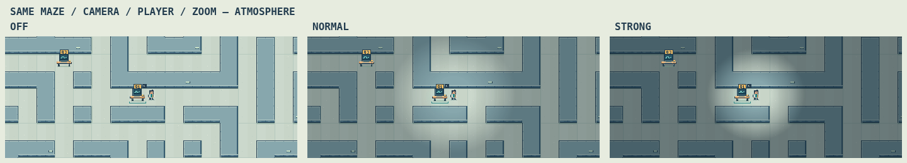
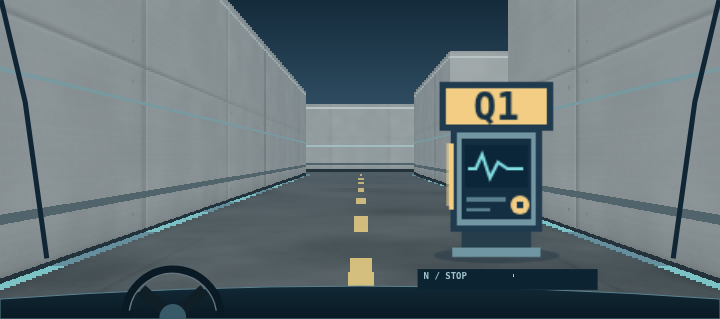

# Digital Electronics EMI Maze Quest

Read [AGENTS.md](AGENTS.md) and [Plan.md](Plan.md) before development.

The **unified 1.0.0-rc1 candidate** on `feature/3d-showcase` contains both
independently deployable editions: **English Lite** in [`student/`](student/)
and the approved **3D educational/showcase edition** in
[`showcase3d/`](showcase3d/README.md). Both use the unchanged v1/v2 validators,
four/five-question assignments and one selected answer; any accepted label
passes. All manifests ship empty. Instructor JSON is displayed verbatim.
The offline instructor GUI and shared schemas remain in `tools/` and `schemas/`.

Lite's application-owned interface is now English, with its technical badge
removed. Its approved 2D artwork, slash, atmosphere, 2.5D driving, maze generator,
physics, progress and map allowance are preserved. The 3D runtime is unchanged
from the approved P2.1.1 fullscreen fix. **V** switches views; the 3D **M** key
opens its cumulative 30-second full map. The separate synthetic demo and Windows
`Start-Showcase.cmd` launcher remain available.

Build the reproducible **Engineering-Maze-Lab-1.0.0-rc1.zip** and the existing 3D
Windows ZIP with the commands in the [unified packaging and Apache guide](release/README.md).
The unified ZIP contains `lite/`, `3d/`, a guide and a hashed release inventory;
it excludes teacher tools, schemas, tests, private drafts and credentials.
For upgrades, copy runtime files first and index last, **preserving every live
`assignments/` file, including its manifest**. Never overwrite a live manifest
with the package's empty bootstrap manifest. Deployment remains manual.

In GitHub **Actions → Unified release candidate — Lite + 3D**, select the run
for the candidate's exact SHA and inspect all three jobs, including every step:
English Lite/Python/Tk/Chromium, WebGL/educational/cross-edition checks, and the
Windows PowerShell launcher. Scroll to **Artifacts**, download and extract:

- **unified-release-…**: unified ZIP, English interface screenshots, traces,
  cross-edition JSON evidence and browser test logs.
- **showcase3d-p2.1-…**: the existing 3D Windows ZIP, screenshots, route videos,
  traces and benchmark JSON.
- **lite-regressions-…**: Python, GUI and all Lite browser suite logs/results.
- **showcase3d-windows-launcher-…**: Windows HTTP/launcher evidence.

Artifacts upload even on failure and expire after 14 days. Read the
[combined readiness report](docs/unified-release-results.md) for actual run URLs,
counts, source commit, hashes, changed files and review limitations. The work
branch's existing **Regression tests** workflow remains available separately.
No automatic deployment, repository secrets or write-enabled Actions token is used.

The historical **`lite-v1.0`** baseline at `823786b`, **`showcase3d-p0-approved`**
at `f685a21` and **`showcase3d-v1.0.0-rc1`** at `94c8a03` remain immutable.
The 69-file historical Lite manifest stays frozen; explicit English UI/test
expectations and reversible UI edits supplement it. Exact generator and driving
parity checks remain active. The unified candidate is identified by its source
SHA and ZIP; it does not move the older 3D tag.
**Stop for instructor review. Do not merge into `work`/`main` or create the final
`v1.0.0` tag.** The eventual approved `main` commit and single release tag will
contain both editions together.

The offline Tkinter/ttk teacher editor supports S01–S12,
private incomplete drafts, four/five questions, local Allow Play, validated unit
exports and a public manifest containing only allowed units with current exports.
It now creates **v2** drafts with **three/four options per question** and teacher
checkboxes for **one or more accepted answers**. Students choose one answer;
any accepted label passes. V1 files remain editable in their original format;
use **Convert v1 to v2** to create an explicit migrated copy. Phase 3 provides a static
student site supporting both versions. Phase 5A adds original laboratory-themed
approved 2D pixel artwork and atmosphere/interaction feedback. Phase 5B enhances
the first-person driving artwork while preserving the shared gameplay and physics.
Phase 5B.1 adds realistic cached materials and fixes Windows reduced-motion slash suppression.
Historical Phase 5B.1 behavior remains covered by the unified candidate regressions.

## Teacher editor — Windows 11

1. Install [Python 3.12 for Windows](https://www.python.org/downloads/windows/).
   Keep the installer’s **Tcl/Tk and IDLE** component enabled. No pip packages
   are required for the application.
2. Obtain the unified candidate's **feature/3d-showcase** branch, keeping `tools/` and `schemas/`
   together. In PowerShell, change to the extracted/cloned project folder.
3. Check Tkinter, close its demo window, then launch the editor:

```powershell
py -3.12 -m tkinter
py -3.12 tools\assignment_editor.py
```

On systems where `python` selects Python 3.12, use
`python tools/assignment_editor.py`. The application needs a desktop display;
it runs locally without a web server or Internet connection.

Keep private drafts in a folder such as
`C:\Users\<name>\EMI Maze Quest\teacher_data`, outside web directories. Use a
separate local export folder such as
`C:\Users\<name>\EMI Maze Quest\export\assignments`. Create/select these folders
in the native file dialogs. The editor does not create or load files on startup.

Save incomplete work with **Save Draft** (`Sxx.draft.json`). Use **Open Draft
Folder** to reopen all twelve standard filenames, or **Load / Import** for an
individual draft/public unit. **Validate Unit** reports exact question/field
errors. Select a local export folder, **Export Selected Unit JSON**, mark the
intended units **Allow Play**, then **Export Public Manifest JSON**. Missing,
changed or invalid exports block manifest generation.

For authoring references with other filenames, use **Import Reference**. To open
the supplied incomplete S01 reference explicitly at launch:

```powershell
py -3.12 tools\assignment_editor.py --reference "C:\path\to\S01_reference_v2_incomplete.json"
```

Its missing URLs remain empty and block public export. The supplied course
content is private, not a public fixture or Git source. In this development
workspace, the initial private draft is prepared at `teacher_data/S01.draft.json`
(ignored by Git); open it with `--draft teacher_data/S01.draft.json`. Do not copy
that private draft into `assignments/` or upload it. No authoring data auto-loads.

Save and export are separate actions. Manually upload the chosen `Sxx.json`
files **first**, then `manifest.json` **last**. There is no upload/sync function.
Never upload private drafts, the entire repository, or the test fixtures.

See [the editor guide](docs/assignment-editor-guide.md) for four/five-question
editing, unsaved changes, overwrite handling and a manual verification checklist.
Linux/Xvfb GUI regressions passed. The instructor also reports successful
question editing on Windows 11; other native GUI workflows/macOS still need
manual verification.

## Student site — Phase 5B.1

The deployable website is **`student/` only**. It loads the relative
`assignments/manifest.json`, lists only explicitly published S01–S12 entries,
and validates the selected v1/v2 file before starting a fresh attempt. Published
older units remain selectable for practice. Use the HUD unit button to return
to selection; **重新整理清單** refreshes the public manifest without a cache purge.
Opening or refreshing the selector pauses your attempt. Use **返回目前挑戰**,
**取消，返回目前挑戰**, or Escape to resume with the same maze/progress/map time.
Loading a unit while playing requires confirmation; your current attempt is
replaced only after the selected file passes validation. A failed load can safely
return to the current attempt.

```sh
python -m http.server 8000 --bind 127.0.0.1 --directory student
```

Open `http://127.0.0.1:8000/`. The committed public manifest is intentionally
empty: no instructor keys or synthetic assignments are published. For a real
release, manually upload only allowed, validated `Sxx.json` exports to the
website's `assignments/` directory **first**, then upload `manifest.json` **last**.
Upload only `student/` runtime files, never the entire repository, private drafts,
exports or tests. Paths also work when this directory is hosted under a nested
Apache URL such as `/~teacher/course/maze/`; a directory URL must end with `/`,
or use `index.html`.

Four/five-question state, actual three/four options and v2 accepted-label arrays
are retained. One answer button submits one label using the existing validator
helper. Both 2D and driving views, V/E/WASD/arrows, 150%/175% zoom and cumulative
30-second map allowance remain available. Confirmed successful unit loading and
browser reload start fresh attempts. Selector cancel/manifest refresh preserve
the current attempt, while stopping movement and pausing map time. No student
progress is stored across browser reloads. Errors offer retry or safe return.

No build, backend, upload, login or form-management service is needed. Public
JSON is readable by students; it is not secure answer storage. The canonical
shared validators remain in `js/`; byte-identical copies in `student/js/` keep
the deployment self-contained. Update both together: a regression check rejects
drift. The original prototype remains unchanged below.

```sh
python tests/browser_student.py
python tests/browser_gameplay.py
```

This optional Playwright/Chromium suite creates temporary static sites, copies
synthetic fixtures there, tests directory/index URLs and cacheable static JSON,
and removes them afterward. Test hooks exist only in intercepted test responses.
No fixtures or browser-testing infrastructure are included in `student/`.
Phase 4 adds deterministic routes using actual keyboard events and movement
updates, without teleporting. It saves synthetic screenshots, Playwright traces,
state/error logs and placement metrics in ignored `test-results/phase-4/`.
See [Phase 3](docs/phase-3-results.md) and [Phase 4 results/changed files](docs/phase-4-results.md).
Phase 5B adds laboratory-themed driving artwork; the approved 2D renderer is
unchanged. WebKit could
not be installed because its download hosts return HTTP 403 under the cloud
network policy; Chromium results do not establish Safari compatibility.

## 2D artwork review — Phase 5A

The 2D maze now uses an original lab-coat character, calm laboratory floors,
connected walls, oscilloscope terminals and a purple locked/unlocked exit.
Character and tile atlases are generated locally by `student/js/rpg-renderer.js`;
no image downloads, build step or third-party art assets are needed. Include this
new JavaScript file when manually updating the complete `student/` directory.
The approved 2D renderer, gameplay and HUD dimensions are preserved in Phase 5B.

Phase 5A.3 preserves the approved **Off / Normal / Strong** atmosphere. Strong is the default
unless you saved another choice. Use the compact **氣氛** selector on desktop
or **2D 氣氛 / Atmosphere** in the progress/help panel on narrower screens.
Only this cosmetic preference is stored locally; assignment progress and
answers are never saved.

Off restores the original bright Phase 5A artwork and immediate question opening.
Normal and Strong retain the approved 33% and 50% distant shading, spotlight
radii and restrained station/finish glows. In 2D, E plays an energy arc anywhere,
including empty corridors and passed stations. Free slashes follow the player
while walking and do not pause exploration or change progress. Deliberate presses
can retrigger after 180 ms; holding E does not repeat. Space, canvas clicks and
the touch button use the same action.

Only a nearby incomplete question starts a pending question interaction. It
pauses movement/map time and opens the actual dialog after 460 ms in Normal or
600 ms in Strong. An unlocked finish uses the same delay before offering its
Google Form; a locked finish stays locked. Escape, restart, switching units/view/
modes, blur or hiding the page safely cancel the cue. Atmosphere Off skips the
animation and delay. **Windows Animation effects OFF does not disable the slash**:
Normal/Strong still show their full sequence under `prefers-reduced-motion: reduce`.
Changing that preference during a slash/pending question preserves its deadline.
Use Atmosphere Off to explicitly disable the effect. Other passive motion remains
reduced when the system requests it. The teacher map stays clear and softens scene
shading. Free E has no map-time charge; an open map counts normal viewing time.
Driving interaction remains immediate and has no slash.



[Character directions and animation sheet](docs/images/phase-5a-character.png) ·
[Current real E close-up](docs/images/phase-5a3-slash.png) ·
[Phase 5A.3 results, evidence, changed files and deployment checks](docs/phase-5a3-results.md) ·
[Phase 5A.2 results, performance, changed files and limits](docs/phase-5a2-results.md) ·
[Previous refinement report](docs/phase-5a-refinement-results.md) ·
[Original Phase 5A report](docs/phase-5a-results.md)

```sh
python tests/browser_visuals.py
python tests/browser_refinement.py
python tests/browser_atmosphere.py
python tests/browser_slash.py
```

The visual suite uses synthetic S02 data and fixed maze seeds. It generates
before/after viewport screenshots, character/object sheets, station and exit
states, an intersection and the frozen/current driving comparison in `test-results/phase-5a/`.
Its `performance.json` records three paired camera-sweep trials at 1366×768,
1024×768 and 390×844. Traces/screenshots are included by the existing CI artifact
upload. Timing measures headless browser scheduling and JavaScript drawing-call
cost; it is not a laptop hardware or Safari performance guarantee.

The refinement suite adds light-position/readability checks, four-direction
swipe/expiry checks, pending modal/cancellation/reduced-motion coverage,
updated review images and comparisons against the frozen reviewed Phase 5A
renderer. Outputs are in `test-results/phase-5a-refinement/`, included in the
same CI artifact. Its performance data includes both normal exploration and a
stress workload with repeated interactions; the archived comparison renderer
stays in `tests/fixtures/visuals/`, outside the student site.

Phase 5A.2 additionally saves matched mode views at all three sizes, real E-input
frames at 0/100/250/400/650 ms, timing/pause/cancellation logs, a short Playwright
WebM video and mode/effect benchmarks in `test-results/phase-5a2/`. The temporal
screenshots advance the browser's clock through the production animation path;
a separate live-clock test checks actual reveal latency. Video recording uses
development-only Playwright FFmpeg, installed with
`python -m playwright install chromium`; no video dependency is deployed with the
student website.

Phase 5A.3 adds `test-results/phase-5a3/`: actual E-input frames for all four
directions, close-ups, lighting parity and stale-cache tests, and
`explore-slash-question.webm`. The recording shows repeated free slashes, walking
while slashing and approaching Q1 through real movement before its dialog opens.
It uses synthetic assignments only and is included in the same CI artifact.

## First-person driving review — Phase 5B.1

Driving uses cached brushed composite/metal panels and mottled epoxy flooring,
with recessed joints, restrained contact shading, distance-filtered grain,
cyan edge channels on actual road boundaries, and restrained depth lighting.
Q1–Q5 electronics terminals retain their identifiers after passing: amber marks
incomplete terminals and mint/check marks completed ones. A transparent EXIT
gantry distinguishes locked/unlocked finish states. Stop near a station and press
E as before; passing a checkpoint never opens a question automatically.

The lower cockpit has slimmer pillars, steering feedback, a speed strip and an
N/D/R indicator. Reduced motion disables optional bobbing, wheel animation and
status-light pulses. The vehicle model, 12× virtual-distance scale, widened road
mask, collision geometry and roughly 30 FPS driving-render cap are unchanged.
Approved 2D artwork, spotlight/shadows and atmosphere persistence remain
unchanged. Phase 5B.1 corrects explicit slash availability under OS reduced motion.



[Previous Phase 5B comparison](docs/images/phase-5b-before-after.png) ·
[Checkpoint and finish states](docs/images/phase-5b-checkpoints.png) ·
[Full Phase 5B report, results, performance and changed files](docs/phase-5b-results.md)

```sh
python tests/browser_drive.py
python tests/browser_materials.py
```

`test-results/phase-5b/` contains matched frozen/current views of straight roads,
left/right turns, corners, T/four-way junctions, walls, checkpoints/finish states
and mobile layouts. It also contains control-replay/road-mask/depth results,
three-viewport performance trials, traces/error logs and
`driving-keyboard-demo.webm`. The live browser recording follows real driving
updates under scripted W/S/A/D keyboard events, then Playwright V/E/Escape input;
it shows acceleration, a turn, braking, Q1 interaction and return to driving.
Its initial pose uses a deterministic synthetic route. The existing Phase 4
tests still navigate complete assignments from start using actual controls.

[Phase 5B.1 report, exact changed files and measurements](docs/phase-5b1-results.md) ·
[Matched materials](docs/images/phase-5b1-comparison.png) ·
[Native-resolution materials](docs/images/phase-5b1-native.png) ·
[Slash with simulated Windows animation disabled](docs/images/phase-5b1-reduced-slash.png)

The paired Phase 5B/5B.1 material gallery, native frames, actual driving video,
three-viewport timings, geometry/filtering results and traces are in
`test-results/phase-5b1/`. Its `slash/` folder contains the system-preference
matrix and real E-key recordings under **both** simulated motion preferences.
The existing full gameplay/2D suites remain in CI.

For a manual Apache update, upload **all three JavaScript files first**:
`student/js/drive-materials.js` (new), `student/js/game.js`, and
`student/js/rpg-renderer.js`; upload **`student/index.html` last**. Keep the full
`student/` bundle together. There are no external texture assets. Never upload
the repository root, tests, private drafts or test recordings.

Open **`index.html?v=5b1-1`**. Network must show successful relative requests for
all three scripts with **`?v=5b1-1`**. In DevTools Console:

```js
[document.documentElement.dataset.gameRelease,
 MazeRpgVisuals.release, MazeDriveMaterials.release] // ["5b1-1", "5b1-1", "5b1-1"]
document.querySelector('#atmosphereSelect').value    // "off", "normal" or "strong"
matchMedia('(prefers-reduced-motion: reduce)').matches // OS/browser preference
```

With Windows 11 Animation effects OFF, Normal/Strong must still slash after E.
Confirm empty-corridor E, a question's complete pre-dialog animation, and Off's
explicit disabling in a local browser. The approved spotlight is unchanged.
No automatic deployment/server synchronization is added.

## Automated checks on GitHub Actions

Every push to **`work`** runs [Regression tests](https://github.com/chingchechung/ece_hw_webproject/actions/workflows/ci.yml)
from `.github/workflows/ci.yml`. It uses a GitHub-hosted Ubuntu 24.04 runner,
Python 3.12, Node 24, real Tk under Xvfb and Playwright-managed Chromium.
`requirements-dev.txt` pins development-only Playwright, JSON Schema and screenshot
dependencies. The student website and teacher editor retain their existing runtime
requirements. The workflow has only `contents: read`, uses no repository secrets,
and performs no deployment, uploads of course data or server synchronization.

The job runs all Python/schema/model tests, Tk GUI tests, original browser tests,
browser validator parity, student loading tests, Phase 4 walking/driving tests,
Phase 5A visual, refinement, atmosphere and slash checks, Phase 5B preservation,
driving visual/control/recording/performance and Phase 5B.1 material/preference checks
and the assignment CLI. All required dependencies are checked; skipped tests fail
the CI runner. Independent suites continue after a failure so logs are retained.

To review a run and download evidence:

1. Open the repository's **Actions** tab, select **Regression tests**, then choose
   the run whose branch is `work` and commit matches your push.
2. Open **Ubuntu / Chromium / Python 3.12** to see installation and test logs.
   Confirm the whole job is green, not just a YAML check or browser installation.
3. On the run summary, download the **ubuntu-chromium-python312-…** artifact.
   Artifacts are uploaded even when tests fail and retained for **14 days**.
4. Unzip locally. `ci/summary.json` reports suite exit codes, skipped checks and
   counts; `ci/*.log` contains full command output/tracebacks. Browser folders
   include screenshots, `.trace.zip` traces and `.errors.json` diagnostics;
   `phase-4/` also contains synthetic state and route/placement measurements.
   View a trace with `python -m playwright show-trace <path-to-trace.zip>`.

Only generated `test-results/` is uploaded from a fresh CI checkout. Tests use
synthetic fixtures and temporary drafts; private `teacher_data/`, `export/`, real
student information and instructor answer keys are never artifact inputs. Artifacts
are for regression review, not student-site deployment.

To run the same suite locally on Ubuntu:

```sh
sudo apt-get update
sudo apt-get install -y python3-tk xvfb xauth fonts-noto-cjk
python -m pip install -r requirements-dev.txt
python -m playwright install --with-deps chromium
xvfb-run -a -s "-screen 0 1440x1000x24 -nolisten tcp" python tests/run_ci.py
```

In Codex Cloud, the suite automatically falls back to an available system
`chromium`/`chromium-browser` if the Playwright download is unavailable. To choose
an installed Chromium explicitly, set `EMI_BROWSER_EXECUTABLE=/path/to/chromium`.
A missing override fails clearly. Use the Cloud's available display/Xvfb rather
than assuming `sudo` is available. The browser helper and artifacts stay in `tests/`.

Optional macOS/WebKit strategy (separate from required Ubuntu CI): use a dedicated
macOS runner or developer machine, install Python 3.12 and `requirements-dev.txt`,
then run `python -m playwright install webkit`. Run the four browser scripts with
`EMI_BROWSER=webkit` and no Chromium executable override:

```sh
EMI_BROWSER=webkit python tests/browser_baseline.py
EMI_BROWSER=webkit python tests/browser_validation.py
EMI_BROWSER=webkit python tests/browser_student.py
EMI_BROWSER=webkit python tests/browser_gameplay.py
```

Keep its results/artifacts labelled separately and initially run it manually or
as an optional job; Tk native GUI testing on macOS is a separate desktop check.
Playwright WebKit is not Safari. Even a passing macOS/WebKit run would still need
manual checks in actual Safari (focus, new tabs, input, display scaling and driving)
before claiming Safari compatibility. No macOS/WebKit success is claimed by the
Ubuntu/Chromium workflow. Phase 5B.1 now stops for instructor review before further work.

## Original student prototype

The working v1.2 baseline is `emi_maze_dualview_v1.2/index.html`, extracted
byte-for-byte from the supplied ZIP. It remains the fixed-question baseline;
use `student/` for JSON-driven assignments.

Run the original prototype locally:

```sh
python -m http.server 8000 --bind 127.0.0.1 --directory emi_maze_dualview_v1.2
```

Open `http://127.0.0.1:8000/`. Serve only the student directory, never private
draft/export directories or the whole repository on a public server.

Run standard-library tests:

```sh
python -m unittest discover -s tests -v
```

Optional browser baseline test (development dependencies above and Chromium):

```sh
python tests/browser_baseline.py
```

That test starts and stops its own loopback HTTP server, stubs external video
navigation, and writes ignored screenshots to `test-results/`.

Phase 1 adds [the v1 data contract](docs/data-contract-v1.md), JSON Schemas,
matching Python/browser validators, and a read-only local CLI. The prototype
retains its demo data; the separate `student/` entry point loads unit JSON.
The [v2 contract](docs/data-contract-v2.md) adds versioned multi-accepted-answer
validation in Python and JavaScript while preserving the original v1 schema.

```sh
python tools/validate_assignments.py tests/fixtures/manifest.json assignments/manifest.json
python tools/validate_assignments.py tests/fixtures/v2/manifest.json
python tests/browser_validation.py
```

`tests/fixtures/` contains complete **test-only** S01 (four questions), S02 (five
questions), and a test manifest. `tests/fixtures/v2/` contains separate synthetic
v2 examples, not the supplied course reference. Never deploy these directories.
The public bootstrap manifests in `assignments/` and `student/assignments/`
contain empty allowlists and no unit files.
`teacher_data/` and `export/` are ignored private local directories; keep actual
drafts outside any served web directory. Validation does not upload or export.

The runtime Python tools use only the standard library. Node runs optional
Python/JavaScript parity tests; the optional `jsonschema` test package checks
the formal Draft 2020-12 schemas. Both checks ran in this environment. Browser
scripts require no npm install, bundler, CDN, or build step.

Real GUI smoke tests (native dialogs are mocked; Tk widgets actually run):

```sh
python tests/gui_smoke.py
# Linux with Xvfb installed:
xvfb-run -a python tests/gui_smoke.py
```

Phase reports: [Phase 0](docs/phase-0-baseline.md), [Phase 1](docs/phase-1-validation.md),
[Phase 2](docs/phase-2-results.md), [Phase 3](docs/phase-3-results.md),
[Phase 4](docs/phase-4-results.md), [Phase 5A](docs/phase-5a-results.md),
[Phase 5A refinement](docs/phase-5a-refinement-results.md),
[Phase 5A.2](docs/phase-5a2-results.md), [Phase 5A.3](docs/phase-5a3-results.md),
[Phase 5B](docs/phase-5b-results.md), [Phase 5B.1](docs/phase-5b1-results.md).
Development stops after Phase 5B.1 for instructor review.
See also the [v2 schema/editor revision results](docs/phase-2-multianswer-results.md).
