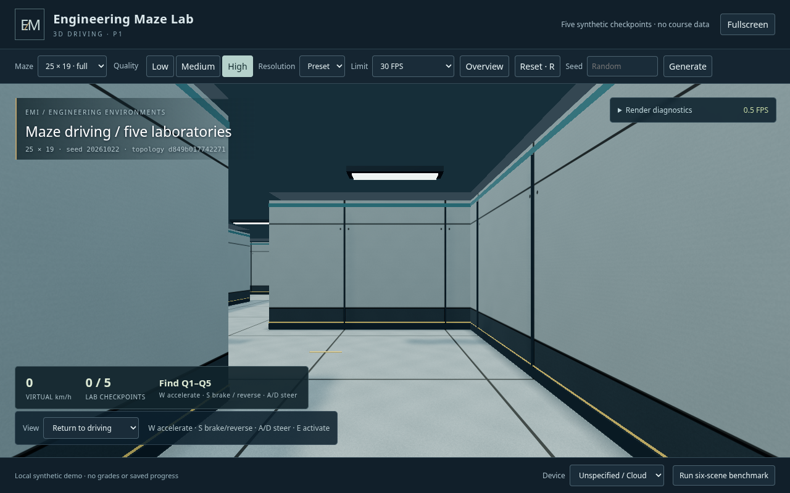

# 3D-P1 — Lite driving and synthetic laboratory interactions

Implemented on `feature/3d-showcase` only. The instructor approved P0 and reports
that its High preset is very smooth and visually excellent on a physical UHD
770. This is **qualitative feedback**, with no numerical FPS measurement.
P1 driving and Arc 140V presentation performance still require physical review.
**Stop after P1; no P2 educational JSON/question integration or merge to work/main.**

## Baselines and delivery

Approved P0 commit: `f685a21e391cdb0848b851e6bf2b72707c77162a`, now preserved by
new immutable annotated tag **`showcase3d-p0-approved`**. No existing tag was
replaced. Lite remains **`lite-v1.0`** at
`823786bc01b68901455061d5fe31d6076c61f20e`. `student/`, tools/GUI, schemas,
validators, assignments, original prototype, all existing Lite tests and
`.github/workflows/ci.yml` remain byte-identical. The 69-file preservation check
and the unchanged Lite suite both pass.

The application, its tests and static runtime remain under `showcase3d/`.
Root guidance/README and this report document the authorized P1 continuation.
The feature workflow retains read-only permissions, no secrets and no deployment.

Extract **showcase3d-p1-static.zip** from the feature workflow artifact and
double-click **Start-Showcase.cmd**. The existing built-in PowerShell/.NET
loopback static server still serves only `dist/` and opens the browser. No Node,
npm, Python, Internet, administrator privileges or build is required at the
venue. The optional Python stdlib launcher remains available. See the
[offline presentation guide](../showcase3d/README.md).

## Authoritative maze and state boundary

The build-time adapter still reads the approved Lite generator without editing
Lite. Its source SHA-256 remains
`03cd7fe5e60aec7d9cb47a799a8facfd73e4e3137602f5fd4edadb73b34ea564`.
It now also writes `src/maze/lite-generated.js`: an ordinary static ES module
containing that exact generator source inside a deterministic clock/random
wrapper. The browser never loads Lite source or executes eval, a VM or a Function
constructor. The generated file is not a second author-maintained algorithm;
its byte identity and outputs are checked against the authoritative source.

Runtime generation supports all four original sizes, five stations and uint32
seeds. Blank seed means new crypto-random seed; an explicit seed reproduces the
same map. Seed 0 retains Lite's existing fallback to RNG seed 29. Invalid seeds
leave the current attempt intact. All original P0 fixed maps and benchmark seeds
remain unchanged. New layouts use a labelled FNV-1a diagnostic fingerprint;
original P0 benchmark data retains its SHA-256 identity. Cache decisions include
size and seed, so the fingerprint is not used as a security or sole identity test.

The pure gameplay modules own vehicle, five checkpoint identities/positions,
completion flags, exit and interaction state. Rules read authoritative maze data,
never mesh names, ray intersections with artwork or camera inspection position.
The renderer consumes that data. Checkpoint screens are offset 1.25 m toward a
wall using the original P0 placement function; their logical interaction centres
and the finish retain the original source coordinates.

## Coordinate units and physics parity

Centralized helpers in `src/gameplay/coordinates.js` distinguish:

| Quantity | Unit / mapping |
| --- | --- |
| Logical maze cell | Original width/height, e.g. 25×19 |
| Logical centre → Lite world pixels | `((2*x+1)*28, (2*y+1)*28)` |
| Drive-road subcell | 14 Lite world pixels |
| Three.js X/Z | Lite x/y × `(0.7/14)` |
| Road subcell in Three.js | 0.7 m |
| Vehicle speed | Original virtual units/s |
| Map displacement | `speed*dt/12` Lite world pixels |
| Maximum visible world speed | `590/12*(0.7/14)` ≈ 2.4583 m/s |
| Collision samples | Original centre, four corners, four sides at radius 6 px (0.3 m per axis) |
| Interaction centre range | <70 world pixels (3.5 m), with wall visibility check |
| Interaction speed gate | Absolute virtual speed ≤25 |

`src/gameplay/driving.js` is a pure data adaptation of `updateDrive()`,
`driveRoadAt()`, `canDriveStand()`, `chooseDriveHeading()` and the DDA ray distance.
It preserves acceleration 320, braking 620, exponential coasting 1.35, forward
cap 590, reverse cap -135, the 1.4 stop threshold, stationary/low-speed steering,
reverse steering sign, nine collision samples, axis-separated sliding, .65
sliding speed reduction and virtual distance accumulation. The .045 s frame cap
matches the actual Lite frame caller, including dropping excess elapsed time
after stalls. It prevents long-frame tunnelling without changing the equations.
No intentional driving-physics change was introduced.

Tests execute the actual immutable Lite functions in a Node VM and compare
**33,600 frame transitions** (4 sizes × 6 seeds × 1,400 steps), including gas,
coast, brake, reverse, simultaneous inputs, steering, walls and long elapsed
values. Position, heading, speed, distance, walk and moving flags match exactly.
A separate real-corner case verifies one-axis sliding and exact .65 reduction.
The runtime generator matches authoritative VM output for all 24 size/seed cases,
including station/finish placement, road masks and reachable logical paths.

The first-person camera follows the vehicle directly at 1.65 m eye height.
Heading always follows steering; reversing does not rotate the view by 180°.
Mouse drag only changes vertical look while driving. Inspection allows mouse yaw
without changing the vehicle. No passive bob/shaking/blur was added, so no
optional camera effect needs a reduced-motion override. Props remain non-colliding;
wall clearance and movement are governed by the approved Lite model.

## Checkpoints, exit, controls and lifecycle

W/Up accelerates; S/Down brakes/reverses; A/D or Left/Right steers. E or the nearby
activation button operates a synthetic lab only within range and below the speed
gate. A wall-visibility guard prevents activating a marker across a divider; this
is an interaction safeguard, not a change to driving physics.

E immediately marks an incomplete lab activated once and shows an acknowledgement
such as **Q1 · LAB 01 — Checkpoint Activated**. Completed labs stop offering their
original activation; screens turn green and the compact HUD updates. All five
completed flags unlock the exit's material/sign. Driving to the exit and pressing
E shows the synthetic completion screen. The finished attempt stays stopped until Reset/Generate; completion feedback says
so explicitly. R also resets while a dialog button has focus. No actual question, answer validator,
course JSON, YouTube, Forms, grading, identity or submission feature is added.

The HUD shows virtual speed/reverse, progress, nearby identity and E/braking
hint. Size/seed, quality and Reset/Generate controls remain visible without page
scrolling. Inspection/overview is explicitly paused, with a return-to-driving
control. Both preserve vehicle position and progress and stop velocity/input.
R/Reset clears vehicle position, speed, heading/steering, distance, completion,
finish, held keys and dialogs while retaining the current seed. Generate/size
selection creates a fresh attempt. Blur/hiding and dialogs release input and
stop the vehicle. Reload starts fresh; no localStorage, cookies, IndexedDB,
progress import/export or persistent student state is added.

The diagnostic snapshot permits read-only inspection of state. Normal URLs have
no simulation-clock hook. Explicit `?testClock=1` enables bounded clock advancement
using the same real held-key input and physics path; it cannot set positions.
Benchmark JSON exports timing/resource data, not saved gameplay progress.

## Preserving P0 visuals and resources

A frozen ten-file P0 source baseline and hash manifest were created **before**
new controls. It builds only into ignored `test-results/3d-p1/p0-runtime/`.
PBR materials, studio environment and quality definitions remain byte-identical.
Walls, floor geometry, world UVs, batching, lighting values and camera inspection
poses are retained. Paired Chromium captures compare straight/wall/floor regions
at Medium and High: all **six** local comparisons have **RGB RMS 0/0/0**.
These compare static materials/illumination; expected checkpoint/exit feedback and
HUD changes are assessed separately. The approved renderer was not replaced.

Static meshes rebuild only when maze data changes. Same-seed regeneration/reset,
checkpoint activation, HUD updates, camera switching and quality changes do not
rebuild geometry. Quality changes swap material maps and shadow targets, disposing
old resources. Interactive screens repaint their existing CanvasTextures and
update material state only on state changes; no meshes/textures are allocated
per frame. Same-map benchmark views reuse geometry. Changing map disposes old
geometry/instance buffers and preserves the original renderer cleanup checks.

WebGL context loss pauses driving; recovery recreates generated PMREM/shadow
render targets and reuses retained CPU data. Pixel comparison and state checks
cover recovery. Unsupported WebGL 2 shows the original useful driver/acceleration
fallback. Runtime dependencies remain local Three.js **0.180.0**, bundled by
pinned esbuild **0.25.12**, with reproducible committed `dist/` and MIT attribution.

## Automated results and CI

The local full suite passed **203 tests**: 151 unchanged Lite, 40 showcase Node
and 12 showcase browser tests, with zero failures/skips. A focused rerun validates
final benchmark resource/state refinements. Actual final GitHub verification is
recorded below after the feature push; YAML syntax alone is not acceptance.

| Checks | Coverage |
| --- | --- |
| Unchanged Lite: 151 | Schema/model/source, Tkinter/Xvfb, validation/loading, complete gameplay, all approved Phase 5 regressions; four CLI manifests |
| Showcase Node: 40 | P0 tests, source/geometry preservation, generator parity, coordinate conversion, exact driving parity, collisions/sliding, interaction state, pure input-route replay, frozen visual baseline and reproducible builds |
| Showcase Chromium: 12 | WebGL/relative offline bundle, sizes/presets/disposal, driving/mouse/reset, DPR/fullscreen/projector, context recovery/fallback, benchmark export, screenshots/video, full control route, blur/regeneration/mode preservation and paired P0 pixels |
| Windows launcher | Seven static HTTP/MIME/HEAD/path-boundary checks; no physical GPU claim |

Actual commands used:

```console
npm run build --prefix showcase3d
npm test --prefix showcase3d
DISPLAY=:97 python tests/run_ci.py
python showcase3d/tests/browser_showcase.py
python showcase3d/scripts/package.py
```

The accepted control-driven browser route starts at the actual 13×9 entry, seed
**20264049**. It uses **44 real keyboard holds**, six E activations and **73.453 s**
of explicitly accelerated simulation time. There is **no vehicle-position setter**.
It accelerates, brakes, turns, follows traversable corridors, rejects high-speed E,
activates Q2/Q1/Q4/Q5/Q3, then drives to and activates the unlocked exit. Browser
position/heading/distance matches the independent pure-physics replay within
1e-7. Static geometry rebuild count stays fixed throughout. It also verifies
completed activation cannot repeat and Reset cancels the completion dialog.

The separate workflow retains Ubuntu/Python 3.12/Chromium, Node 24 and Windows
PowerShell jobs, read-only token permissions, no secrets and no deployment.
All synthetic screenshots, traces, console/failure logs, video, benchmark JSON,
Node/browser results and the standalone static ZIP upload even on failures.
They remain outside the deployable `dist/` directory and expire after 14 days.

## Evidence and performance

All screenshots/video are captured from the real application.



[Completed checkpoint](images/3d-p1/checkpoint-completed.png) ·
[Demonstration completion](images/3d-p1/demonstration-complete.png)
 Full evidence is
under ignored **`test-results/3d-p1/`** and the GitHub artifact. A few safe PNGs are
committed under **`docs/images/3d-p1/`**. Important files include:

- `driving-hud-laptop.png`, `acceleration-before-braking.png`, `steering-near-wall.png`.
- `checkpoint-within-range.png`, `checkpoint-before.png`, `checkpoint-after.png`.
- `activated-Q1.png` … `activated-Q5.png`, `activated-EXIT.png`.
- `exit-locked.png`, `exit-unlocked.png`, `full-maze-overview.png`.
- `matched-medium.png`, `matched-high.png`, `projector-1920x1080.png`.
- `control-route.json`, `control-completion.json`, `navigation-evidence.json`.
- `video/*.webm`: ordinary real-time navigation and the complete control-driven
  route with its explicitly accelerated simulation clock. These are functional
  evidence, not fabricated frames or Intel FPS demonstrations.
- `p0-visual-parity.json`, six paired P0/P1 captures, recovery pixel deltas,
  `browser-results.json`, per-test JSON/logs/traces, `cloud-benchmark.json`.
- `showcase3d-p1-static.zip`: allowlisted runtime/launchers/guide/license only.

Cloud uses Linux Chromium/ANGLE SwiftShader software WebGL 2, not either Intel
GPU. Local browser/version and measurements are exported in artifacts. The
six-scene benchmark retains the original fixed seeds, map sizes and camera route;
it pauses/restores the current attempt instead of losing progress. Cold initial
Medium setup is labelled separately. Frame intervals, CPU submission and optional
asynchronous GPU queries remain distinct; unavailable/disjoint GPU timings are
null/discarded. Do not interpret Cloud frame rates as hardware throughput.

Presets remain Low/Medium/High scales .70/.85/1.00, buffer caps
1280×720 / 1600×900 / 1920×1080, PBR maps 128²/256²/512², anisotropy 1/4/8 and
static shadows off/512²/1024². Render DPR stays 1 at Windows 150% scaling; manual
scale stays capped. Default cap is 30 FPS; 60 FPS remains an evaluation option.
In the local matched scene, all three presets reported 19 draws / 11,212 triangles
and 24 uploaded geometries; textures stabilized at 13 Low and 14 Medium/High.
Counts depend on visibility and prior uploads. No progress-driven geometry growth
was observed. Resource estimates retain P0's 0.5/2/8 MiB PBR mip budgets, ~4 MiB
screen maps, approximate environment/shadow/framebuffer allowances, excluding
browser/driver overhead. They are estimates, not measured VRAM. Arc's reported
16GB is shared-memory reporting, not guaranteed dedicated VRAM.

## Physical-device review checklist

Use the same static package and benchmark settings on both Windows 11 devices.
P0 High is qualitatively approved on UHD 770; P1 controls/interactions and all
numerical performance results remain pending. Arc 140V presentation review is
also pending. Linux Chromium and a Windows launcher job do not establish physical
Chrome/Edge presentation or macOS/Safari compatibility.

1. Launch offline using Start-Showcase.cmd. Confirm the expected Intel/ANGLE
   hardware renderer, browser/driver, power mode, window size and display scaling.
2. On UHD 770 begin Medium or the approved High visuals at 30 FPS. On Arc 140V
   begin Medium at 1280×800 / Windows 150%, then evaluate High and Low/Medium 60.
   Record actual internal resolution; no preset is a guaranteed frame-rate result.
3. Drive W/S/A/D: accelerate, coast, brake, reverse, turn while stopped and at
   low speed, slide against a wall and take 90° intersections. Confirm heading
   remains stable when stopping/reversing and no camera/wall/floor clipping.
4. Drive to all five labs, verify high-speed E is rejected, stop and activate each
   once. Confirm green feedback/progress, locked exit before all five, then drive
   to the unlocked exit and press E. No questions/Forms should appear.
5. Test Reset while moving and during a dialog; all progress/keys/speed must clear.
   Generate multiple blank/random seeds and repeat an explicit seed on each size.
6. Use overview/inspection, hold W there, and return: position/progress must be
   preserved with zero speed. Alt-tab/hide/return must release inputs.
7. Switch all quality presets; observe unchanged maze/progress and stable resource
   counts. Test fullscreen and a 1920×1080 projector, recording mirror/extend mode,
   browser zoom/DPR and label readability without scrolling.
8. Run the same six-scene benchmark for each agreed preset/cap/resolution on both
   machines. Reload for initial Medium cold setup; select desired quality, warm
   and repeat at least three runs. Export local JSON after each. Do not use the
   test-clock URL for hardware measurement. Rehearse at least 10 minutes for
   sustained thermals, responsiveness, resources and recovery/reload behavior.
9. Return JSON, representative captures and driving/visual feedback. Test Edge
   separately from Chrome; physical Safari/macOS remains unverified.

## Known differences, limits and P2 boundary

Driving equations and units match Lite. P1-specific differences are synthetic
immediate activation dialogs, a line-of-sight interaction guard, in-memory demo
progress, and separate inspection cameras; they do not alter Lite or its physics.
There is no full question UI, v1/v2 assignment loading, wrong-answer shrinking,
teacher-map budget, Forms, student tracking, persistence, multiplayer or new
physics engine. Props remain visual and non-colliding. Automatic quality scaling
and passive camera effects remain deferred. Context recovery is supported where
the browser restores WebGL; reload guidance remains available if it fails.

Next is **P1 instructor driving review**, then explicitly approved **P2** work:
reuse the existing assignment loader/validators and question UI contracts,
including v1/v2, four/five questions and single-choice acceptance semantics.
Generalize checkpoint count/data at that boundary without replacing rendering or
the approved driving module. No P2 integration has begun.

## Exact changed files


Status: A = added, M = modified, D = superseded generated asset removed.

```text
M	.github/workflows/showcase3d.yml
M	AGENTS.md
M	Plan.md
M	README.md
A	docs/3d-p1-results.md
A	docs/images/3d-p1/checkpoint-completed.png
A	docs/images/3d-p1/demonstration-complete.png
A	docs/images/3d-p1/driving-high.png
M	showcase3d/README.md
A	showcase3d/dist/app-JABOVFIP.js
D	showcase3d/dist/app-PB2RGZYH.js
D	showcase3d/dist/app-RD2YC7DH.css
A	showcase3d/dist/app-RYFAG6EX.css
M	showcase3d/dist/build-info.json
M	showcase3d/dist/index.html
M	showcase3d/index.html
M	showcase3d/launch.ps1
M	showcase3d/package-lock.json
M	showcase3d/package.json
A	showcase3d/scripts/build-baseline.mjs
M	showcase3d/scripts/build.mjs
M	showcase3d/scripts/export-maze.mjs
M	showcase3d/scripts/package.py
M	showcase3d/serve.py
M	showcase3d/src/camera/controller.js
A	showcase3d/src/gameplay/attempt.js
A	showcase3d/src/gameplay/coordinates.js
A	showcase3d/src/gameplay/driving.js
M	showcase3d/src/main.js
A	showcase3d/src/maze/generate.js
M	showcase3d/src/maze/layout.js
A	showcase3d/src/maze/lite-generated.js
M	showcase3d/src/scene/geometry.js
M	showcase3d/src/style.css
M	showcase3d/tests/browser_showcase.py
M	showcase3d/tests/bundle.test.mjs
A	showcase3d/tests/control-route.mjs
A	showcase3d/tests/fixtures/p0/baseline.json
A	showcase3d/tests/fixtures/p0/index.html
A	showcase3d/tests/fixtures/p0/src/camera/controller.js
A	showcase3d/tests/fixtures/p0/src/main.js
A	showcase3d/tests/fixtures/p0/src/materials/laboratory.js
A	showcase3d/tests/fixtures/p0/src/maze/layout.js
A	showcase3d/tests/fixtures/p0/src/maze/maps.json
A	showcase3d/tests/fixtures/p0/src/performance/metrics.js
A	showcase3d/tests/fixtures/p0/src/performance/quality.js
A	showcase3d/tests/fixtures/p0/src/scene/geometry.js
A	showcase3d/tests/fixtures/p0/src/style.css
M	showcase3d/tests/launcher-smoke.ps1
A	showcase3d/tests/physics.test.mjs
A	showcase3d/tests/visual-baseline.test.mjs
A	showcase3d/tests/write-route.mjs
```
