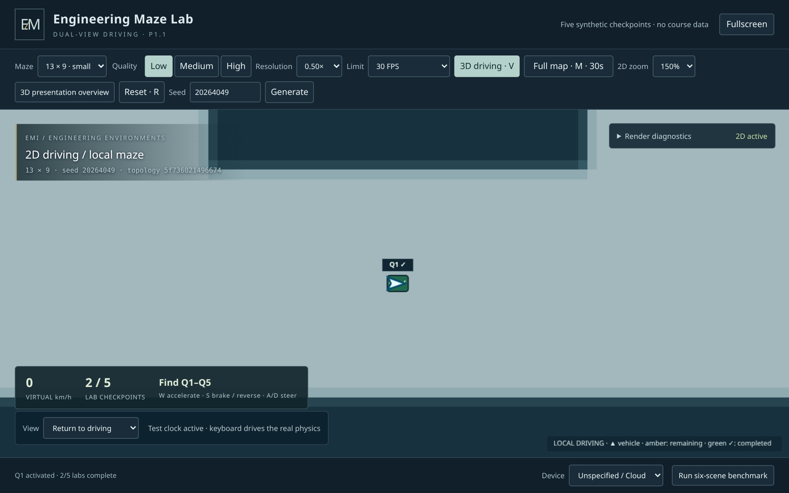

# 3D-P1.1 — Dual-view navigation and cumulative full map

Development stays on **`feature/3d-showcase`**, continuing reviewed P1 commit
**`cbfde0133cf274b662b499d9d93be223e1e9e8b9`**. The instructor approved physical
P1 maze driving and requested easier exploration through a switchable 2D view.
P0 High has qualitative UHD 770 approval; no numerical Intel FPS was supplied.
P1.1 navigation and Arc 140V presentation review remain pending.
**Stop after P1.1. No P2 educational integration or merge into work/main.**

## Architecture and preservation

There is one authoritative maze and one `attempt.vehicle`. The existing
`physicsTick()` still calls the unchanged pure `stepDriving()` for either driving
presentation. `view` retains the P1 driving/inspection/overview lifecycle;
`drivingView` records the intended `3d`/`2d` presentation. Diagnostics also expose
explicit `navigationView` values `driving3d`, `driving2d`, `overview`, `inspection`.
The full map is a paused overlay, not a second vehicle or driving mode.

V and the visible driving-view button stop velocity/steering and release held
controls, then change presentation. Position, heading, virtual distance, walk,
seed, checkpoint flags, exit state and the attempt survive exactly. No geometry
rebuild, regeneration, teleport or movement toward selected markers occurs.
W/S/A/D, arrows, E and R use the same existing controller and physics path.
V/M ignore key repeat, typing/select controls and active checkpoint dialogs.

Overview and scene inspection retain the approved P0/P1 cameras. They pause and
preserve the vehicle; returning restores the intended 2D or 3D driving view.
The overview button/caption explicitly say **3D presentation overview** /
**Presentation only**, distinguishing this existing unlimited architecture tool
from the timed gameplay map. V/M operate in driving views. Entering an inspection
closes the timed map without restoring its allowance.

Lite `student/`, Python GUI/tools, schemas, validators, assignments, original
prototype, existing Lite tests and stable CI are unchanged. The original 40
showcase Node and 12 browser tests are preserved; new tests are separate files.
Driving equations, coordinate helpers, generator/maps, scene geometry, PBR
materials, quality presets and the frozen P0 comparison fixture are unchanged.
The existing `lite-v1.0` and `showcase3d-p0-approved` tags remain intact.

## Canvas 2D map and coordinates

`src/scene/map2d.js` consumes the same `driveRoad.bits`, width and height as the
3D geometry. Existing road rectangles and wall-boundary runs fill a static Canvas
cache; there is no additional generator. Lite world pixels remain authoritative:
one road subcell is **14 pixels**, rendered as **0.7 m** in 3D. Markers use the
shared `attempt.checkpoints[].position` and `attempt.exit.position` directly.
The approved 3D terminal artwork still sits 1.25 m toward a wall from its logical
anchor; tests remove that offset and compare anchors, rather than moving markers
to the artwork's offset position.

Projection applies one uniform scale to both world axes. The heading triangle
uses the actual vehicle heading with x right/y down, corresponding to 3D X/Z.
It indicates the vehicle's orientation and supplies no target guidance. Amber
circles label incomplete Q1–Q5; green boxes/checks retain completed identities.
EXIT uses distinct LOCKED/OPEN colors and text. A small identity tag remains
readable when the vehicle is sitting on a marker. The common HUD reports lab
progress. No answers or future educational content are present.

The ordinary 2D camera follows the player and clamps at map boundaries. Zoom
choices are **125%, 150%, 175%**, default **150%**. The base scale adapts to the
viewport and maze, preserving aspect ratio and restricting the visible span to
at most **48% of each maze dimension**, even on the smallest map/projector at
125%. This stays a local driving view. The separately timed map fits the entire
topology with margins for controls. Neither surface scrolls the page.

## Full-map state and timer policy

`src/gameplay/navigation.js` owns pure allowance operations. Each new shared
attempt contains **`map: { remainingMs: 30000, open: false }`**. M/the map button
opens/closes it; Escape also closes it. Opening pauses speed and held controls;
E cannot activate while the overlay is open. All markers, progress and lock
state come from the same attempt as the 3D view.

Elapsed time uses monotonic `performance.now()` independently of the capped
physics delta. It counts only while the full overlay is open, the document is
visible and its window/tab has focus. Visibility/focus events settle the previous
visible interval before changing clock eligibility. Hidden/unfocused intervals,
WebGL context loss, and closed-map time do not consume or restore allowance.
At zero the overlay closes, disables reopening and preserves the local 2D view.

Closing/reopening, V, zoom, quality, overview/inspection, dialogs and benchmarking
do not reset time. **R/Reset** explicitly begins a new attempt with the same seed;
**Generate/size selection** begins another new attempt, even with the same seed.
Only those new attempts restore 30 seconds. Invalid seed input preserves state.
No persistence is added; reload starts fresh as in P1.

The explicit diagnostic simulation clock never advances this wall-clock budget.
No timer/position setters are exposed to ordinary runtime URLs.

## Rendering, diagnostics and offline delivery

Canvas 2D reuses one small topology cache, regenerating it only when actual road
bits/dimensions change. Reset, same-map generation, zoom, progress and V reuse it.
Dynamic overlays redraw at the existing render cap. Canvas backing resolution
tracks CSS pixels at render DPR 1, including Windows-style DPR 1.5 emulation.
While 2D or the full map covers the scene, the frame loop skips WebGL rendering.
The context, geometry, materials, environment and shadow resources stay available
for immediate return. Existing context-loss recovery remains active.

The diagnostics panel identifies Canvas 2D activity instead of presenting stale
3D FPS as current output. Read-only snapshots include the last map paint, cache
build/byte counts, CPU paint mean and a WebGL-frame counter. Local benchmark JSON
omits gameplay and map-marker snapshots. Benchmarking from 2D uses the original
six 3D scenarios, then restores the chosen driving view and shared attempt. Close
the timed overlay before starting a benchmark.

The dependency versions remain Three.js **0.180.0** and esbuild **0.25.12**.
Reproducible local `dist/` still has no CDN. The allowlisted package is now
**`showcase3d-p1.1-static.zip`**. Extract it and run **Start-Showcase.cmd**; built-in
PowerShell/.NET serves only `dist/` on loopback. No Node/npm/Internet is required
at the venue. Detailed Windows instructions are in
[the presentation guide](../showcase3d/README.md).

## Automated tests

The local suite passed **216 tests**, with zero failures/skips: 151 unchanged
Lite, 48 Node, 12 original showcase browser and five P1.1 navigation browser
tests. All four CLI manifests validated. The original browser run took 822.290 s;
the final windowed navigation run took 216.249 s. The complete implementation
also passed the executed GitHub Actions run below.

| Suite | Required coverage |
| --- | --- |
| Lite: 151 unchanged tests | Python/schema/model, Tkinter/Xvfb, all approved validation/gameplay/visual suites; four CLI manifests |
| Showcase Node: 48 | Existing 40 plus eight allowance, projection, local crop, zoom, marker/terminal anchor, completion and reset checks; all sizes and deterministic seeds |
| Original showcase Chromium: 12 | Existing full keyboard route, offline paths, presets/resources, context restoration, fallback, benchmark and frozen P0 pixel comparisons |
| P1.1 windowed Chromium: 5 | Complete mixed-view keyboard route; identical trajectories; exact transition state; resource stability; cumulative timer, hidden/focus intervals and exhaustion; sizes/seeds/zoom/DPR/projector/fullscreen; overview/inspection, benchmark, interactions and recovery |
| Windows launcher | Existing seven HTTP/MIME/HEAD/path-boundary checks |

### Verified GitHub Actions delivery

[Feature run #5 — success](https://github.com/chingchechung/ece_hw_webproject/actions/runs/39742589866)
executed on 2026-10-22 for implementation commit
**`aeebe0c019f1e24e06da4dacda114e4052880e39`**. All three jobs succeeded:

- [Showcase build, Node and Chromium](https://github.com/chingchechung/ece_hw_webproject/actions/runs/39742589866/job/119703204602):
  48 Node tests passed with zero failures/skips; the generated bundle matched.
  All 12 original browser tests passed in **875.364 s**, including P0 visual
  comparisons. All five P1.1 tests passed in **159.088 s**, including the complete
  mixed-view route, native tab focus, timer exhaustion and context recovery.
- [Unchanged Lite](https://github.com/chingchechung/ece_hw_webproject/actions/runs/39742589866/job/119703204954):
  all 151 regressions passed and all four CLI manifests validated.
- [Windows offline launcher](https://github.com/chingchechung/ece_hw_webproject/actions/runs/39742589866/job/119703204857):
  seven checks passed. Downloaded `results.json` confirms PowerShell
  **5.1.26100.33648**; `server-errors.log` is empty. This is an HTTP launcher test,
  not a physical GPU or Windows navigation benchmark.

Download artifacts while signed into GitHub with repository access:

| Artifact | Review contents |
| --- | --- |
| [showcase3d-p1.1-39742589866-1](https://github.com/chingchechung/ece_hw_webproject/actions/runs/39742589866/artifacts/12410148926) | `3d-p1/` original showcase evidence; `3d-p1.1/` Node/navigation results, screenshots, traces, video, timer/resource JSON and **showcase3d-p1.1-static.zip** |
| [showcase3d-windows-launcher-39742589866-1](https://github.com/chingchechung/ece_hw_webproject/actions/runs/39742589866/artifacts/12410115988) | Downloaded/checked launcher result and server logs |
| [lite-preservation-39742589866-1](https://github.com/chingchechung/ece_hw_webproject/actions/runs/39742589866/artifacts/12410227477) | Existing synthetic Python/Tk/browser evidence and complete Lite summary |

In `3d-p1.1/dual-view-route.json`, `video` identifies the accepted full-route
recording under `3d-p1.1/video/`. Original P1 videos remain under `3d-p1/video/`.
All three artifacts uploaded successfully with 14-day retention, expiring
**2026-11-05 UTC**. The final delivery commit updates only this report;
application, bundle, tests and workflow are identical to the verified source
commit above. The feature workflow's runtime path filter excludes report-only
commits, so this documentation update does not start another run.

Navigation tests use a real Chromium window under Xvfb on Linux. Playwright
normally forces every page to report focus; the tab-activation test disables
that protocol emulation on both tabs before switching native tab focus. It also
tests an emulated document-hidden event, actual wall-clock exhaustion, repeated
openings and successful 2D driving afterward. Tests may not silently skip.

The complete route uses the existing synthetic **13×9, seed 20264049** keyboard
plan. It starts in 3D, drives/brakes at the first checkpoint/intersection, turns,
presses V, continues to Q1 in 2D, activates it with E, opens/closes M, then presses
V to return to 3D and completes all remaining labs and the exit. It checks
independent replay coordinates/heading/distance within 1e-7 and confirms every
switch preserves exact state. No vehicle position is assigned. The video uses
an explicitly accelerated simulation clock, real held keys and actual V/M/E.
This is functional evidence, not an Intel FPS measurement.

Commands run from the repository root:

```console
npm run build --prefix showcase3d
npm test --prefix showcase3d
xvfb-run -a python tests/run_ci.py
python showcase3d/tests/browser_showcase.py
xvfb-run -a -s "-screen 0 2048x1400x24 -nolisten tcp" python showcase3d/tests/browser_navigation.py
python showcase3d/scripts/package.py
```

Codex uses its installed Chromium cache and isolated X displays for the same
commands. The feature workflow retains Ubuntu/Python 3.12/Node 24, the unchanged
Lite job and Windows launcher job. It installs Xvfb/xauth for native tab testing,
runs the original and new browser suites, and uploads both evidence directories
even on failures. Token permissions remain read-only; no secrets or deployment.
All fixtures are synthetic. Test infrastructure and evidence stay outside `dist/`.

## Evidence and performance observations

Full screenshots, traces, console/failure logs, state/results JSON and actual
browser video live in ignored **`test-results/3d-p1.1/`** and the feature artifact.
Original P0/P1 regressions keep their existing `test-results/3d-p1/` evidence.
Representative safe PNGs are committed under **`docs/images/3d-p1.1/`**.



[Same position in 3D](images/3d-p1.1/same-position-3d.png) ·
[Same position in 2D](images/3d-p1.1/same-position-2d.png) ·
[Timed full map with remaining labs](images/3d-p1.1/full-map-remaining-locked.png)

- `same-position-3d.png`, `same-position-2d.png`: exact shared position and heading.
- `q1-incomplete-2d.png`, `q1-completed-2d.png`, `returned-3d-q1-complete.png`.
- `full-map-remaining-locked.png`, `full-map-exit-unlocked.png`.
- `2d-1280x800-dpr150.png`, `2d-1366x768-dpr150.png`,
  `2d-1920x1080-dpr150.png`, `2d-fullscreen-projector.png`.
- `local-2d-after-map-exhausted.png`, eight size/seed full-map captures.
- `dual-view-route.json`: accepted control plan, final state and video basename
  under `video/`; `map-timer-evidence.json`; `dual-view-performance.json`.

The local `dual-view-performance.json` records these observations for 13×9,
seed 20264049, Low preset, 960×700 CSS viewport, DPR 1, a 960×483 map canvas and
Chromium 154.0.8037.57 / ANGLE SwiftShader:

| Resource | Before repeated switches | After 20 additional switches |
| --- | ---: | ---: |
| Three.js uploaded geometries / textures | 23 / 12 | 23 / 12 |
| Scene rebuilds / disposed scenes | 2 / 1 | 2 / 1 |
| Static 2D cache builds | 1 | 1 |
| Cache backing bytes | 119,808 | 119,808 |
| Visible Canvas backing bytes | 1,854,720 | 1,854,720 |

The last rolling Canvas CPU-paint mean was **0.88 ms across 53 paints**. This is
a short software observation, including startup/cache work, not a sustained
hardware benchmark. It measures elapsed JavaScript time issuing Canvas calls,
not compositor/GPU completion. The test also asserts zero additional WebGL frames during
a 350 ms fully covered 2D interval. Browser/driver/compositor overhead is not
included in backing-byte estimates. No Three.js resource growth was observed.
All six local paired P0 Medium/High wall/floor/lighting crops have RGB RMS
**0/0/0**. Software timing does not establish Intel FPS or physical Windows/Arc
performance. No 3D art/lighting optimization or quality reduction was introduced.

## Windows review and limitations

1. Extract the static ZIP completely; launch Start-Showcase.cmd offline in Chrome
   or Edge with graphics acceleration. Confirm renderer/browser/driver and power
   mode in diagnostics. Test UHD 770 and Arc 140V separately.
2. At 1280×800 and Windows 150% display scaling, drive W/S/A/D, brake/reverse and
   turn at an intersection. Press V while moving: position/heading stay fixed,
   speed/input stop. Continue driving in 2D; test all zoom levels and arrow keys.
3. Approach Q1, stop, E, close the same synthetic dialog, then V back. Confirm
   green completed feedback in both views, preserved progress and normal 3D art.
4. Open M briefly, close/reopen and verify cumulative time. Switch tabs and
   alt-tab away; allowance must pause, then resume on return. At zero M closes;
   2D driving still works. Quality/view/zoom changes must not refill time.
5. Complete five labs, verify locked/open EXIT and E completion. Reset during
   driving or a dialog; progress/input clear and map time returns to 30 seconds.
   Generate repeated explicit/random seeds on all four sizes.
6. Enter the clearly labelled 3D presentation overview and each inspection view;
   return to the intended driving view. Run/export the existing benchmark from
   2D; verify the attempt returns intact. Rehearse sustained use and recovery.
7. Repeat at 1366×768 and 1920×1080 fullscreen/projector. Check visible controls,
   marker labels/vehicle heading, no distortion/page scrolling, and smooth
   switching without resource growth. Record actual device measurements.

Physical P1.1 Windows navigation, Intel performance, macOS and Safari remain
unverified. Xvfb/Chromium and Windows HTTP launcher checks do not establish those.
The presentation overview intentionally remains unlimited as requested; P2 must
separately decide how developer/presentation tools are exposed in an educational
release. This phase has no route guidance, questions, assignment JSON, answers,
YouTube/Forms, grades, tracking, backend or persistent progress. Existing prop
artwork stays non-colliding; approved Lite wall physics remains authoritative.
The showcase still requires successful WebGL 2 initialization; this additional
2D presentation is not an unsupported-WebGL fallback. Context loss pauses both
driving views until the original recovery process finishes.

Next is instructor P1.1 navigation review, then separately authorized P2 work.
No P2 integration has begun.

## Exact changed files

Compared with approved P1 `cbfde01`: **31 paths**.
A = added, M = modified, D = superseded generated asset removed.

```text
M	.github/workflows/showcase3d.yml
M	AGENTS.md
M	Plan.md
M	README.md
A	docs/3d-p1.1-results.md
A	docs/images/3d-p1.1/full-map-remaining-locked.png
A	docs/images/3d-p1.1/q1-completed-2d.png
A	docs/images/3d-p1.1/same-position-2d.png
A	docs/images/3d-p1.1/same-position-3d.png
M	showcase3d/README.md
A	showcase3d/dist/app-7TA3ZS5A.css
A	showcase3d/dist/app-J4CQ3FHR.js
D	showcase3d/dist/app-JABOVFIP.js
D	showcase3d/dist/app-RYFAG6EX.css
M	showcase3d/dist/build-info.json
M	showcase3d/dist/index.html
M	showcase3d/index.html
M	showcase3d/launch.ps1
M	showcase3d/package-lock.json
M	showcase3d/package.json
M	showcase3d/scripts/build.mjs
M	showcase3d/scripts/package.py
M	showcase3d/serve.py
M	showcase3d/src/camera/controller.js
M	showcase3d/src/gameplay/attempt.js
A	showcase3d/src/gameplay/navigation.js
M	showcase3d/src/main.js
A	showcase3d/src/scene/map2d.js
M	showcase3d/src/style.css
A	showcase3d/tests/browser_navigation.py
A	showcase3d/tests/navigation.test.mjs
```
