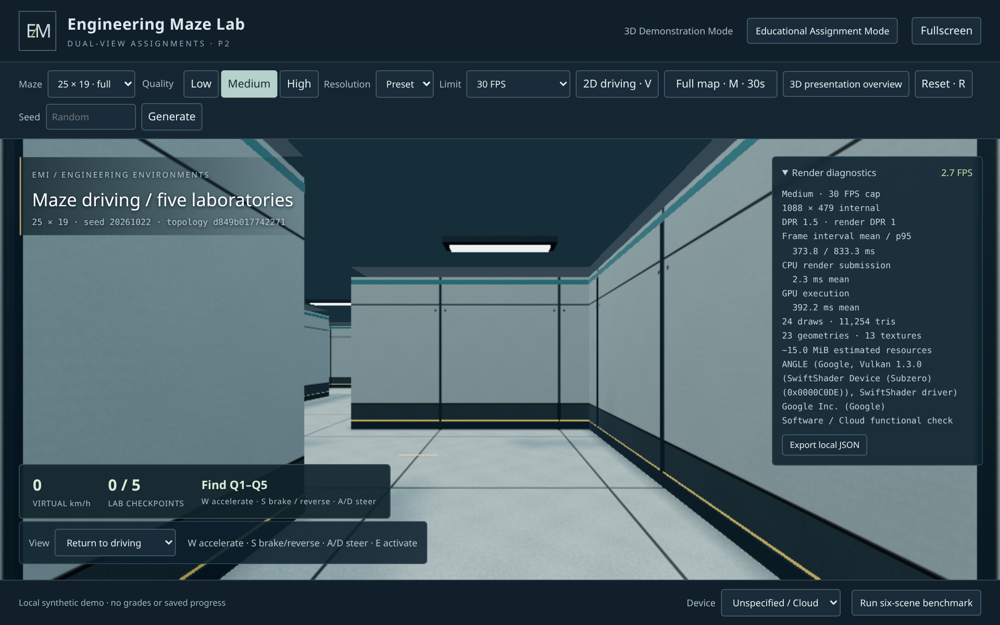
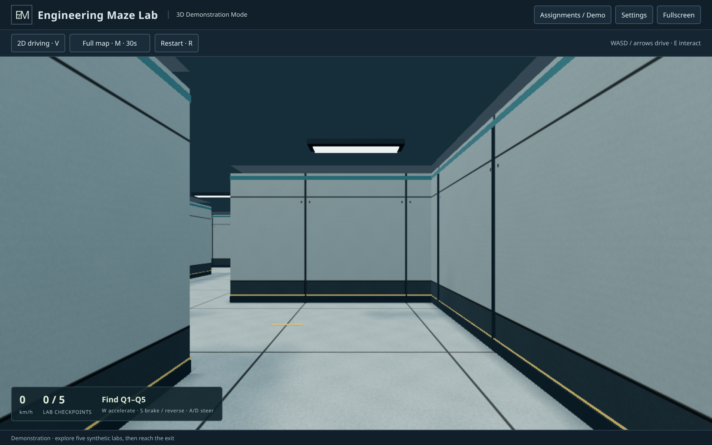
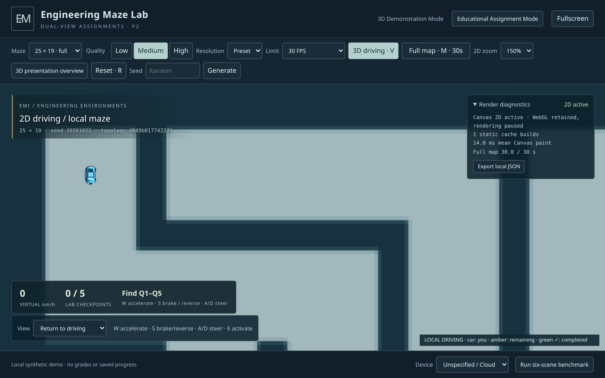
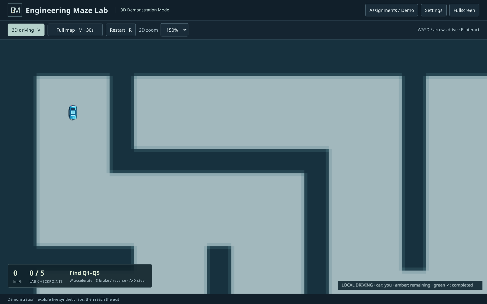

# 3D-P2.1 — Production UI and release candidate

This phase continues approved P2 **`8a9061f0128813700b6a2ca179358b8c27e56447`**
on **`feature/3d-showcase`**. The instructor reports successful university Apache
deployment and play from a separate Windows laptop with Intel Iris Xe, and has
approved P2 gameplay. That is instructor-reported functional approval, not a
numerical GPU benchmark. P2.1 changes production UI and release preparation only.

**Stop after P2.1/RC preparation for instructor Windows/Apache UI review.**
There is no final v1.0.0 tag, automatic deployment, merge into work/main or new
gameplay/physics/graphics/assignment-format phase.

## Production controls and layout

The normal page retains title/mode, **Assignments / Demo**, **Settings**,
**Fullscreen**, **V**, timed **M**, **Restart / R**, conditional 2D zoom and a
compact speed/progress/context HUD. Assignment/question/completion dialogs retain
their approved behavior. The header, driving toolbar, HUD and footer use the
existing laboratory palette and typography with less padding/redundant text.

Removed from normal view: device choice, diagnostics/export, benchmark/cancel,
internal resolution/frame-cap controls, manual seed/size/generation, inspection,
architectural overview and scene/seed/topology captions. The **Device selector
is removed from the current DOM entirely**. No GPU is chosen through the UI;
diagnostics retain actual browser-reported renderer identity. Manual
`selectedDevice` labels are no longer exported. Nothing selects a quality preset
by GPU name or makes assumptions about UHD, Iris or Arc performance.

Settings exposes the original **Low / Medium / High** choices, with **Medium**
still the default and the original 30 FPS default. Preset definitions, framebuffer
limits and render DPR 1 remain unchanged. Its native modal pauses driving/map
accounting, contains keyboard Tab focus, closes on Escape and returns focus to
the game. Quality changes preserve map/player/progress and do not refill time.
A full map is concealed behind Settings or unit selection while its timer is
paused; closing the modal resumes the retained map and remaining allowance.

Measured before/after on local Linux Chromium at DPR **1.5**, same synthetic
default seed/entry and Medium preset; sizes below are **CSS pixels**:

| Viewport | Before game height | After game height | Gain | Visible default controls |
| --- | ---: | ---: | ---: | --- |
| 1280×800 | 564 | 671 | +107 | 18 → 6 |
| 1366×768 | 532 | 639 | +107 | 18 → 6 |
| 1920×1080 | 886 | 951 | +65 | 18 → 6 |

These measurements describe UI space, not FPS or native Windows font metrics.
The normal 2D zoom adds its selector only when needed. No full-page scrolling
or clipped controls is allowed in the browser tests. A larger stage can increase
the framebuffer within the unchanged preset limits; it is not a performance
improvement claim.

## Presenter and developer separation

| Requested interface | Demo capabilities | Active educational assignment |
| --- | --- | --- |
| Normal URL | Essential player controls and Settings | Same player controls and approved question flow |
| `?presenter=1` | Overview, inspection, deterministic seed/size and generation | Presenter tools hidden/disabled and actions rejected |
| `?debug=1` | Diagnostics, benchmark/cancel/export, manual internal scale/frame cap | Debug tools hidden/disabled and actions rejected |
| Both flags | Both demo tool groups | Both groups rejected |

URL flags are convenience switches, not a security boundary. `toolPolicy()`
derives permission from the actual loaded assignment state. Overview/inspection,
generation, benchmark/export and advanced-setting handlers also check permission;
forced DOM events cannot change an educational attempt. The benchmark's internal
camera staging is limited to permitted debug demo runs. All six original
benchmark scenarios, timing methodology, resources and export infrastructure
remain available.

**Player UI** removes tool flags without a reload, preserves the attempt and
returns from an inspection/overview to the authoritative vehicle. It is disabled
while a benchmark runs; cancel/finish first. Returning to player view clears
technical status text. Basic graphics Settings remains available during education.
No new persistence, student records, backend, GPU selection or automatic tuning
is introduced.

## Preservation and regression structure

The new P2 preservation manifest hashes **18 approved components**, plus the
lighting and renderer/camera initialization sections in main. They remain
byte-identical: physics/controller, coordinate transforms, 2D car/map, geometry/
materials, presets/metrics, generator/maps and all assignment modules. Lite,
the teacher GUI, schemas, canonical/shared validators, public manifests, original
prototype, existing Lite tests and stable work CI remain unchanged.

The existing validator/generator/physics tests still execute the actual approved
Lite implementations. V1/v2, four/five questions, multiple accepted labels,
wrong-answer shrinking, R resets, 30-second cumulative map allowance, videos/
Forms, modal/blur behavior and context restoration are preserved.

Existing Showcase tests opt explicitly into presenter/debug mode where they
exercise those controls. Quality changes use the actual Settings dialog; frozen
P0 uses its original toolbar. The completion assertion now checks the visible
word **Restart** instead of Reset; the same R/reset behavior assertions remain.
No original test is deleted. The six P2 browser tests now use the **clean player
UI**, including complete v1-four and v2-five routes with real driving input.

Required regression total: **243**, plus **seven Windows launcher checks**:

| Suite | Tests | Scope |
| --- | ---: | --- |
| Unchanged Lite | 151 | Python/schema/model, native Tk/Xvfb, all existing student/gameplay/visual browsers; four CLI manifests |
| Showcase Node | 65 | Previous 62 plus strict tool flags, every education/tool combination, P2 component/lighting/camera preservation; two-build reproducibility and publication/package checks |
| Original Showcase browser | 12 | Driving/reset, presets/resources, contexts, benchmark, full synthetic keyboard route and matched P0 visual comparisons |
| Navigation browser | 5 | Mixed-view route, trajectories/resources, native tab focus, cumulative map exhaustion, sizes/zoom/projector and recovery |
| Educational browser | 6 | Clean player UI, published-unit/error/cancel/race safety, both full assignments, smaller-maze completion, accepted labels, links, offline and car |
| Production browser | 4 | Default UI/layout/focus, presenter/debug entry/exit, forced actions in every educational configuration, modal map concealment, missing optional DOM and extracted ZIP offline/nested serving |

Local Node checks passed **65/65** with zero skips. The complete clean-player
educational suite passed **6/6 in 375.921 s**. All four production tests passed
in **278.661 s** after fixing native-dialog Tab containment; final status/map
concealment additions passed both focused reruns in **175.007 s**. The full original/navigation
suites and GitHub verification are recorded at final delivery below.

The original 12-test local run passed 11 and reached all labs/EXIT in its full
route, then failed the old **Reset** text assertion. After updating that expected
copy to **Restart**, the complete route, completion and R-clear checks passed
in **49.956 s**. All other original tests passed; the six matched P0 image crops
retain RGB RMS **0/0/0**. The sequential GitHub run provides the final full-suite
verification. No gameplay assertion or route is removed.

Commands from the repository root:

```console
npm run build --prefix showcase3d
npm test --prefix showcase3d
python showcase3d/tests/browser_showcase.py
xvfb-run -a -s "-screen 0 2048x1400x24 -nolisten tcp" python showcase3d/tests/browser_navigation.py
python showcase3d/tests/browser_education.py
python showcase3d/tests/browser_production.py
xvfb-run -a -s "-screen 0 1440x1000x24 -nolisten tcp" python tests/run_ci.py
python showcase3d/scripts/package.py
```

Codex uses its installed Chromium/video cache and isolated X display. Tests use
synthetic fixtures only. Browser clock acceleration still drives the real physics
from held keys; it does not set positions or teacher-map time. Full routes/videos
are functional evidence, not hardware frame-rate benchmarks. External video/Form
destinations are intercepted without submissions.

## Release verification and candidate

This implementation checkpoint has **not yet created the candidate tag**.
Completion requires an actual successful feature workflow and uploaded artifacts.
The annotated **`showcase3d-v1.0.0-rc1`** tag will point to that exact tested
implementation/build commit; existing tags will not be overwritten. The final
report/annotation will bind the source SHA, successful run and package. A later
results-only documentation commit is not substituted for the tested tag target.

The feature workflow retains Ubuntu 24.04/Python 3.12/Node 24/Chromium, the
unchanged Lite job and Windows PowerShell 5.1 launcher job. It adds the production
browser suite, keeps all old suites and uploads all synthetic evidence even on
failure. The Showcase timeout allows the added full-browser checks. Permissions
remain `contents: read`, with no saved checkout credentials, secrets or deployment.

Runtime is committed under **`showcase3d/dist/`**. Build-info records candidate
version **`1.0.0-rc1`**, dependency versions and runtime SHA-256 values. The ZIP is
**`test-results/3d-p2.1/showcase3d-1.0.0-rc1-static.zip`**. Its default publication
is empty, with eleven allowlisted runtime/launcher/guide entries. Packaging checks
version and runtime hashes; no tests, dependencies or private drafts are included.
The extracted ZIP is tested under a nested static URL and offline after loading.
Windows one-click launch still needs no Node/npm/Python/build/Internet at the venue.

## Visual review evidence

Full evidence is under ignored **`test-results/3d-p2.1/`**, with original suites
retaining `3d-p1/`, `3d-p1.1/` and `3d-p2/`. The candidate artifact includes all
four folders. New captures cover 1280×800/DPR 1.5, 1366×768 and 1920×1080, both
views, unit selection, questions, Settings, demo and separate tool interfaces.
`layout-comparison.json` records the before/after measurements. The immutable P2
baseline capture and safe representative PNGs are committed under
**`docs/images/3d-p2.1/`**. No instructor drafts or student information is used.

Before and after, same 1280×800 viewport at DPR 1.5:

| Before P2 | After P2.1 |
| --- | --- |
|  |  |
|  |  |

[Settings](images/3d-p2.1/settings.png) ·
[Unit selection](images/3d-p2.1/unit-selector.png) ·
[Question](images/3d-p2.1/question.png) ·
[Presenter](images/3d-p2.1/presenter.png) ·
[Debug / reported renderer](images/3d-p2.1/debug.png)

## Apache upgrade and instructor review

The [current package guide](../showcase3d/README.md#upgrade-an-existing-apache-site-without-replacing-assignments)
documents a **manual runtime-only** Apache upgrade. Back up the old runtime and
publication outside public paths; upload new hashed JS/CSS, license and build-info
first, index last. **Do not upload the candidate's `assignments/` folder or empty
manifest over the live site.** Keep old hashed assets for cached old index pages.
Refresh the real nested URL, inspect relative requests, refresh the allowlist and
confirm existing published units remain. Roll back runtime/index only, preserving
assignments. New publication is a separate explicit units-first/manifest-last
operation. Builds preserve existing valid assignment bytes; isolated tests prove
two rebuilds retain a synthetic published unit byte-for-byte.

Review the exact tagged candidate on Windows Chrome/Edge and the university
Apache path: normal six-control UI, Settings keyboard/Escape, both views/zooms,
unit-switch cancellation, four/five-question completion, wrong-answer shrinking,
R reset, map consumption/focus/modal concealment, external tabs and context
recovery. Check 1280×800 at Windows 150% scaling, 1366×768 and 1080p fullscreen/
projector. Separately review presenter/debug demo tools and their educational
restrictions; no manual GPU selection should appear.

Native Windows P2.1 UI and Apache upgrade remain for instructor review. Linux
Chromium/DPR emulation and Windows launcher HTTP checks do not establish native
Windows graphics, numerical Intel performance, macOS or Safari compatibility.
Browser renderer identity can be generic. WebGL 2 remains required; this phase
does not add an unsupported-WebGL fallback. Progress is still in memory only.

**No additional phase begins and no final v1.0.0 tag is created before review.**

## Exact changed files

The final delivery lists paths relative to approved `8a9061f` below. Root guidance/
README and this report document authorization/review; UI modules/HTML/CSS/main
implement control separation; build/package/version changes identify the RC;
test changes preserve old coverage and add UI/preservation evidence. No approved
gameplay/rendering component, Lite file, GUI or schema changes.

```text
M	.github/workflows/showcase3d.yml
M	AGENTS.md
M	Plan.md
M	README.md
M	showcase3d/README.md
D	showcase3d/dist/app-4J526KQD.css
D	showcase3d/dist/app-Y2HAESKF.js
M	showcase3d/dist/build-info.json
M	showcase3d/dist/index.html
M	showcase3d/index.html
M	showcase3d/launch.ps1
M	showcase3d/package-lock.json
M	showcase3d/package.json
M	showcase3d/scripts/build.mjs
M	showcase3d/scripts/package.py
M	showcase3d/serve.py
M	showcase3d/src/main.js
M	showcase3d/src/style.css
M	showcase3d/tests/browser_education.py
M	showcase3d/tests/browser_showcase.py
M	showcase3d/tests/publication.test.mjs
A	docs/3d-p2.1-release-results.md
A	docs/images/3d-p2.1/before-1280x800-2d.png
A	docs/images/3d-p2.1/before-1280x800-3d.png
A	docs/images/3d-p2.1/debug.png
A	docs/images/3d-p2.1/player-2d.png
A	docs/images/3d-p2.1/player-3d.png
A	docs/images/3d-p2.1/presenter.png
A	docs/images/3d-p2.1/question.png
A	docs/images/3d-p2.1/settings.png
A	docs/images/3d-p2.1/unit-selector.png
A	showcase3d/dist/app-D7QFAYHC.css
A	showcase3d/dist/app-VZ3UGDYR.js
A	showcase3d/src/ui/modes.js
A	showcase3d/src/ui/settings.js
A	showcase3d/tests/browser_production.py
A	showcase3d/tests/fixtures/p2-preservation.json
A	showcase3d/tests/fixtures/p2-ui-layout.json
A	showcase3d/tests/ui.test.mjs
```
