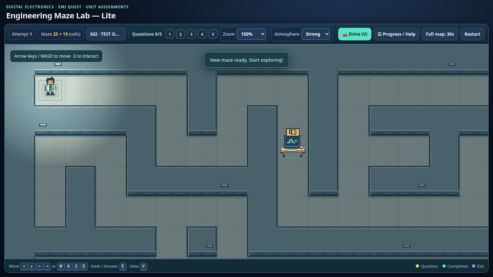
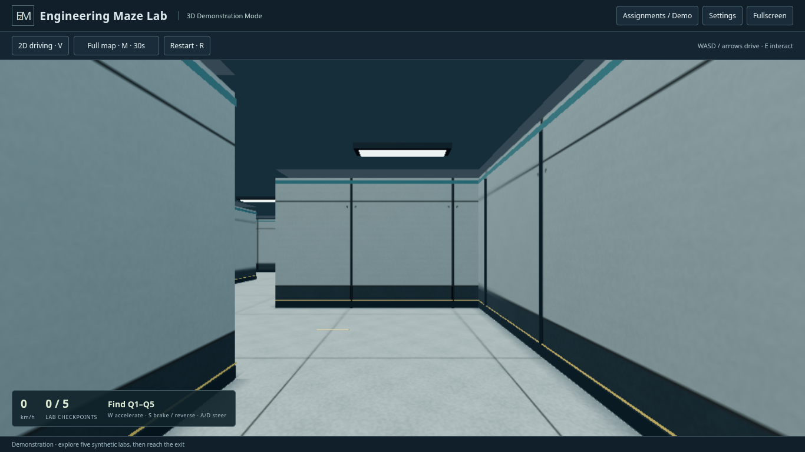

# Unified release candidate — English Lite and approved 3D

Candidate: **1.0.0-rc1**, both editions together on `feature/3d-showcase`.
Lite's application UI is English; the 3D runtime remains the reviewed P2.1.1
build. Historical tags are preserved. No merge, deployment or final tag is made.

Candidate source commit, including the CI guard and deterministic test fix:
`710f6d1d3b70f7dd12eec218300eb3b6aa4c9a33`.
The edition/package implementation is `0b3b5b2390e9de5a30afffb0baca3d745406b9c1`;
the follow-ups change only the workflow shell and a test-server cancellation
race plus its recorded test hash. Both editions and package inputs remain
identical. [Final hosted verification run #11](https://github.com/chingchechung/ece_hw_webproject/actions/runs/39899847958)
completed successfully on 2026-10-23 (Asia/Taipei): **all three jobs green,
253 tests passed, four CLI manifests valid and seven Windows launcher checks
passed**. Both editions pass in this same candidate commit.

| Edition | Application version |
| --- | --- |
| Lite English | `1.0.0-rc1` (approved 5B.1 gameplay/art retained) |
| 3D educational/showcase | `1.0.0-rc1` (approved P2.1.1 runtime retained) |
| Unified package | `1.0.0-rc1` |

## Authorized scope and preservation

Only `student/index.html`, `student/js/assignment-loader.js` and
`student/js/game.js` change in the deployed Lite application. These changes cover
owned English strings, badge removal, HTML language/version metadata and cache
keys for the translated scripts. Inline CSS, IDs, controls, artwork, lighting,
slash behavior, generator, physics and assignment values/rules are retained.
The `5b1-1` renderer/material/gameplay compatibility marker remains separate from
the unified `1.0.0-rc1` application version in the Lite HTML metadata.

The immutable 69-file `showcase3d/tests/lite-baseline.json` is unchanged.
`lite-english-release.json` pins that historical manifest's hash and identifies
exactly seven deliberate current-release differences: the three UI files and
four existing test files whose Chinese/cache/source expectations must change.
The other 62 files still match the historical hashes. A reversible edit ledger
in `tests/fixtures/lite-english-ui.json` recovers every historical byte of all
three UI files. The original source-region hash checks then run against that
recovered source. Generator and driving parity continue against the actual
current source, not a substitute fixture. No preservation test is disabled.

Unchanged protected source includes the Python GUI/model, schemas, shared and
deployed validators/rules, 2D renderer/materials, original prototype, all 3D
application sources, read-only generated adapter, maps and committed 3D runtime.
The historical `lite-v1.0`, `showcase3d-p0-approved` and
`showcase3d-v1.0.0-rc1` tags are not moved. The unified candidate is identified by
its source SHA and ZIP, without creating another tag.

## Package and deployment

`release/package.py` builds the deterministic
`test-results/unified-release/Engineering-Maze-Lab-1.0.0-rc1.zip` from `student/`
and `showcase3d/dist/`. Its 16 entries contain eight Lite files, six 3D files,
README and release-info.json. Fixed entry order, ZIP timestamps, permissions and
compression make repeated builds byte-identical with the same Python/zlib and
inputs. The inventory records both edition versions and every payload hash.

Both manifests must be empty. Unexpected files, private draft filenames,
symlinks, inconsistent versions or a changed 3D build fail packaging. No tests,
private course data, student records, tools, schemas or credentials are deployed.
Teacher `tools/` and `schemas/` remain available together in the source release.
The separate 3D Windows launcher ZIP is also retained and rebuilt.

Follow the [packaging and Apache guide](../release/README.md). Deploy `lite/`
and `3d/` independently under arbitrary nested URLs. For an upgrade, back up
first, upload runtime assets and then index last, **leaving the entire existing
`assignments/` directory untouched**, including every manifest and unit JSON.
Never replace the live manifest with an empty bootstrap manifest. No automatic
publishing or deployment is configured.

## English interface screenshots

Only synthetic fixtures appear in these screenshots. The 3D image uses its
separate synthetic demonstration mode; the Lite image uses a disposable test
assignment, never a published course assignment.

## Actual GitHub Actions results and downloads

[Final run #11](https://github.com/chingchechung/ece_hw_webproject/actions/runs/39899847958)
is **completed / success**, head SHA
`710f6d1d3b70f7dd12eec218300eb3b6aa4c9a33`. Every required step succeeds;
logs confirm zero failed/skipped Node checks and no failed browser/Python suites.
Linux steps use `bash --noprofile --norc -e -o pipefail`; Windows uses PowerShell.

| Job | Actual result |
| --- | --- |
| [English Lite / Python / Tk / Chromium](https://github.com/chingchechung/ece_hw_webproject/actions/runs/39899847958/job/120238661707) | 156 tests pass; four CLI manifests valid |
| [WebGL / education / production / unified package](https://github.com/chingchechung/ece_hw_webproject/actions/runs/39899847958/job/120238661962) | 65 Node + 12 graphics + 7 navigation/fullscreen + 6 education + 4 production + 3 unified browser = 97 tests pass |
| [Windows PowerShell launcher](https://github.com/chingchechung/ece_hw_webproject/actions/runs/39899847958/job/120238661931) | Seven checks pass; PowerShell `5.1.26100.33438`; server-error log empty |

Download these artifacts from the run (GitHub login/repository access may be
needed). They are retained for 14 days; the source scripts reproduce the ZIPs.

- [Unified candidate and English/cross-edition evidence](https://github.com/chingchechung/ece_hw_webproject/actions/runs/39899847958/artifacts/12479453199)
  (`unified-release-39899847958-1`): extract
  `Engineering-Maze-Lab-1.0.0-rc1.zip`, screenshots, traces, requests and logs.
- [3D Windows ZIP and all 3D evidence](https://github.com/chingchechung/ece_hw_webproject/actions/runs/39899847958/artifacts/12479541843)
  (`showcase3d-p2.1-39899847958-1`): the Windows ZIP is inside `3d-p2.1/`.
- [Lite regression logs, GUI/browser evidence and results](https://github.com/chingchechung/ece_hw_webproject/actions/runs/39899847958/artifacts/12478393947)
  (`lite-regressions-39899847958-1`).
- [Native Windows launcher evidence](https://github.com/chingchechung/ece_hw_webproject/actions/runs/39899847958/artifacts/12478775123)
  (`showcase3d-windows-launcher-39899847958-1`).

The final downloaded unified ZIP matches the local ZIP byte for byte: 16 entries,
all inventory hashes verified, both manifests empty. Its four cross-edition cases
(v1/v2 × four/five questions) report identical JSON bytes; all five browser error
reports contain no page errors or artifact-capture errors. The downloaded Windows
results confirm seven passed checks and an empty server-error log. Only synthetic
fixtures appear in browser evidence; neither ZIP contains private course drafts.

## Completed local regressions

The complete local run of the edition/package implementation (`0b3b5b2`)
passes all **253 tests**, with no skipped required checks. After the test-only
cancellation fix, all 12 student browser tests and 21 geometry/preservation
checks pass again. The final hosted run checks the complete candidate commit.

| Suite | Passed |
| --- | ---: |
| Python/model/schema/package | 64 |
| Tkinter GUI | 16 |
| Lite browser suites | 76 |
| Node geometry/preservation/physics/contracts/build | 65 |
| 3D graphics | 12 |
| 3D navigation/native fullscreen | 7 |
| 3D educational routes | 6 |
| 3D production UI/extracted offline ZIP | 4 |
| Extracted unified ZIP/English/cross-edition browser | 3 |
| Total | **253** |

All four assignment CLI manifests are valid. All six Medium/High P0 scene
comparisons have RGB RMS `[0, 0, 0]`. The default Windows ZIP was rebuilt and
contains exactly 11 runtime/launcher entries, including its empty manifest.
The unified ZIP contains exactly 16 entries with both manifests empty.

The added English UI check initially encountered Chinese in an existing
synthetic question prompt. It now exempts only verbatim instructor JSON values
and checks owned interface text separately. The finalized three-test suite
passes in one run; no application code was changed to hide that fixture text.

## Validation and review gate

The workflow is renamed **Unified release candidate — Lite + 3D**. It retains
read-only token permissions, all existing suites, native Windows launcher checks
and failure artifacts. It adds extracted unified-package browser tests and a
separate unified ZIP/evidence artifact. The Lite job name describes preserved
behavior with English UI rather than byte identity to 5B.1. Explicit Bash enables
`-o pipefail` for piped test/log commands, preventing `tee` from masking a test
failure. A local failing pipeline reproduced the inherited default-shell gap;
the corrected workflow is verified by a fresh actual run. Windows retains its
explicit PowerShell shell override.

The added tests cover deterministic/privacy-safe packaging, English desktop and
mobile UI, identical v1/v2 four/five-question JSON accepted by both extracted
editions, unchanged Chinese synthetic instructor text, English correct/incorrect
and completion dialogs, map expiration/reset, and both nested deployment paths.
Existing suites retain control-driven navigation, answer semantics, switching,
failed loads, unit review, 2D/drive modes, 3D demonstration/education, graphics,
native fullscreen Escape/rejections, GUI, validation and no-scroll/error checks.

Ubuntu/Chromium and software WebGL establish functional regressions only.
No new physical Intel GPU, Safari or macOS GUI compatibility claim is made.
The Windows hosted check covers the built-in launcher/HTTP boundary; it is not
a new physical Windows browser/GPU review. The combined candidate has not been
deployed to the university Apache server by Codex. Instructor acceptance of the
English copy and manual target-machine/Apache checks remain the review gate.
The source README retains a separate optional macOS/WebKit strategy.
**Stop for instructor review; do not merge into main/work or create v1.0.0.**

## CI findings resolved before delivery

[Initial run #9](https://github.com/chingchechung/ece_hw_webproject/actions/runs/39895698857)
at `0b3b5b2` passes all 253 tests, four CLI validations and seven Windows checks.
Its downloaded 16-entry unified ZIP matches the local ZIP byte for byte; both
manifests are empty and all five browser error reports are clear.

Checking its logs revealed the inherited shell used `bash -e`, which can mask
failures before `tee`. The workflow now explicitly uses Bash with `-o pipefail`;
Windows retains its PowerShell override. [Run #10](https://github.com/chingchechung/ece_hw_webproject/actions/runs/39898348345)
then reported a real test error in an existing cancellation scenario: the fixed
0.6-second server delay could expire before Playwright clicked Refresh, closing
the unit picker. Application loading behavior was correct.

The test server now holds each relevant response behind explicit started,
release and finished events. It releases superseded S01 only after S02 loads,
and releases the reloaded S01 only after manifest refresh cancels it. All prior
unit/progress/network-error assertions remain, with added request-order checks.
A deliberate 750ms pause exceeds the old timing window without releasing the
response. The focused test and 21 preservation/geometry checks pass locally.
The full student browser suite and final hosted run verify the completed fix.
No application logic, timeout policy or accepted-answer semantics changed.

## Changed files

The candidate changes 23 files relative to `536fa1c` (the edition/package
implementation at `0b3b5b2`, workflow-only guard at `9fe8f1a`, and test-only
request gating/hash update at `710f6d1`):

| Purpose | Files |
| --- | --- |
| Authorized Lite UI only | `student/index.html`, `student/js/assignment-loader.js`, `student/js/game.js` |
| Historical/current preservation | `showcase3d/tests/geometry.test.mjs`, `showcase3d/tests/lite-english-release.json`, `tests/fixtures/lite-english-ui.json`, `tests/lite_localization.py` |
| Retained behavior with English/cache expectations and deterministic cancellation | `tests/browser_gameplay.py`, `tests/browser_student.py`, `tests/browser_slash.py`, `tests/test_drive_contract.py` |
| Added release regressions | `tests/browser_unified.py`, `tests/test_unified_release.py` |
| Unified reproducible packaging and guide | `release/package.py`, `release/version.json`, `release/README.md` |
| CI | `.github/workflows/showcase3d.yml` |
| Guidance and evidence | `AGENTS.md`, `Plan.md`, `README.md`, `docs/unified-release-results.md`, `docs/images/unified-release/lite-english.png`, `docs/images/unified-release/3d-english.png` |

Remote verification also confirms protected refs remain unchanged: `main`
`127bb27155358f405685e78819412417114884e0`, `work`
`823786bc01b68901455061d5fe31d6076c61f20e`, and all three historical annotated
tags (including their original tag objects). No `v1.0.0` tag exists.

The report's subsequent evidence-only commit changes this Markdown report only.
It does not change the tested editions, package inputs, workflow or test sources.

## Approved 3D bundle identity

Rebuilding retains these filenames and SHA-256 hashes:

| File | SHA-256 |
| --- | --- |
| `app-EWW245IQ.js` | `3ad0c8c4be5e3ca20b0c9233fa3d81fecc7ad67b0b08d0d12b5c86b6839f78e7` |
| `app-D7QFAYHC.css` | `bd4ebc90358dc2ffdb6e38cbce665eb029d74fba40960caf7958602494bcf730` |
| `index.html` | `31f32e1655b74f83c96753276c3a67a87117e65c6eb4e968f43ab17ef71435df` |

The local and downloaded GitHub Actions (#9 and #11) unified ZIPs share SHA-256
`26f7d934cf5e290173937fe4c58a33d31602d0150a8ec321a5e4b45bfd485816`.
